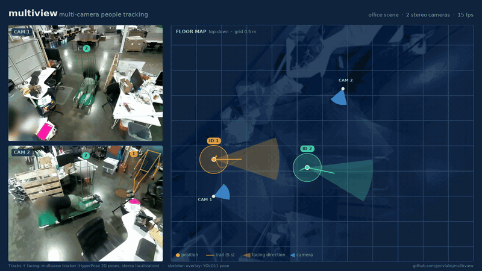

# The PRCV multiview project

multiview was designed and written by [Aaron Michaux](https://github.com/aaron-michaux)
over several years at Perceive. It is maintained by PRCV Labs (Everett Berry),
who open sourced it; the 2026 build modernization was contributed with help
from Claude.



multiview is a large project which combines several components of a people tracking system. It consists of the following functionality:
* Camera calibration for stereo and monocular cameras
* Video I/O and decoding
* Object detection
* 3D Reconstruction
* Pose Detection through OpenPose or HyperPose
* Vector space tracking with several algorithm options
* GUI for debugging 3D data
* Command line interface
* Custom geometry library

Over time we will split this library into components. For a guided walk
through the code and the computer vision it implements, see
[doc/TOUR.md](doc/TOUR.md). For the history of the project, see
[prcvlabs.org](https://prcvlabs.org).

**Contents**

1. [Quick start: build and test](#1-quick-start-build-and-test)
2. [Run it on real data](#2-run-it-on-real-data)
3. [Customize the build](#3-customize-the-build)
4. [Using multiview](#4-using-multiview)
5. [Developing](#5-developing)

## 1. Quick start: build and test

Everything installs in user space: no `sudo`, no system CUDA. You need Linux
x86_64 with `curl`, `bzip2` and `git`, about 6 GB of disk, and, for the GPU
code, an NVIDIA driver that supports CUDA 12.8 (driver 570 or newer; check
with `nvidia-smi`). Without a GPU everything still builds and the CUDA code
falls back to the CPU.

```
git clone https://github.com/prcvlabs/multiview.git
cd multiview
build/setup-env.sh                     # micromamba + the 'multiview' environment
build/build.sh                         # multiview-cli and multiview-testcases
multiview/multiview_cpp/build/cmake-release/multiview-testcases
```

The tests need no external data and should end with `All tests passed`.
A clean build takes about 4 minutes on 10 cores; rebuilds are much faster
because `ccache` is used automatically.

Tested on Ubuntu 24.04 with an NVIDIA GeForce RTX 3090 (driver 595), CUDA
12.8, GCC 13.4, OpenCV 4.12 and Boost 1.86. All dependencies come from
conda-forge via [`build/environment.yml`](build/environment.yml).

## 2. Run it on real data

The calibration data, and each testcase's manifest and ground truth, are
bundled in [`data/`](data/README.md), and scenes load from there by default.
The videos are in the Hugging Face dataset
[prcvlabs/multiview-retail-tracking](https://huggingface.co/datasets/prcvlabs/multiview-retail-tracking),
which is freely downloadable; no login is needed.

```
build/fetch-testcases.sh 7             # into ~/multiview-data/testcases
CLI=multiview/multiview_cpp/build/cmake-release/multiview-cli
TC=~/multiview-data/testcases/007_site03_sparse_tracks
$CLI dump_default_params -d /tmp/007 $TC/manifest.json
```

To run the full pipeline, including pose detection, build with HyperPose
(see [Pose detection](#pose-detection-hyperpose) below), run the pipeline once
to get a `params.json` in its output directory, and use that file as the
template for later runs:

```
$CLI pipeline -m $TC/manifest.json -d /tmp/007-run -y --start 0 --n-frames 100
$CLI pipeline -m $TC/manifest.json -p /tmp/007-run/params.json -d /tmp/007-run2 -y
```

`build/fetch-testcases.sh --list` lists the testcases, and
`build/fetch-testcases.sh all` downloads all of them. `./bin/testcase.sh`
runs a testcase end to end and downloads it if needed.

## 3. Customize the build

`build/build.sh` takes an optional build type and targets, and reads extra
CMake flags from `MULTIVIEW_CMAKE_ARGS`:

```
build/build.sh Debug multiview-testcases
MULTIVIEW_CMAKE_ARGS="-DMULTIVIEW_WITH_AWS=OFF" build/build.sh
```

| Variable | Default | Effect |
|---|---|---|
| `MULTIVIEW_CMAKE_ARGS` | | Extra flags passed to CMake. |
| `MULTIVIEW_BUILD_DIR` | `multiview/multiview_cpp/build/cmake-<type>` | Build directory, e.g. a separate one for a HyperPose build. |
| `CMAKE_BUILD_PARALLEL_LEVEL` | number of cores minus 2 | Compile jobs. |

The options below are all independent. Pick the ones you need.

<details>
<summary><b>No NVIDIA GPU</b></summary>

```
MULTIVIEW_CMAKE_ARGS="-DMULTIVIEW_WITH_CUDA=OFF" build/build.sh
```

The CUDA kernels are skipped, rectification and stereo run on the CPU, and
the GPU testcases are skipped. A build with CUDA on also runs on a machine
without a GPU, falling back to the CPU at runtime.
</details>

<details>
<summary><b>GPU stereo and rectification</b> (on by default with CUDA)</summary>

With `MULTIVIEW_WITH_CUDA=ON` (the default), rectification uses a native CUDA
remap kernel, and `MULTIVIEW_WITH_LIBSGM=ON` builds the vendored
[libSGM](multiview/contrib/libSGM) for the GPU `CUDA_SGM` disparity strategy.
`CMAKE_CUDA_ARCHITECTURES` defaults to the GPUs found by `nvidia-smi`; set it
to build for others, e.g. `-DCMAKE_CUDA_ARCHITECTURES=75;86`.

OpenCV's own GPU StereoBM/SGBM (`WITH_OPENCV_CUDA`) is enabled automatically
if your OpenCV was built with the `cudastereo` module. The conda-forge OpenCV
was not, so those strategies run on the CPU.
</details>

<details>
<summary><b>Without the AWS SDK</b></summary>

```
MULTIVIEW_CMAKE_ARGS="-DMULTIVIEW_WITH_AWS=OFF" build/build.sh
```

Only needed for `s3://` asset stores. When off, S3 access raises an error.
</details>

<details>
<summary><b>Pose detection (HyperPose)</b></summary>

Pose detection uses [HyperPose](https://github.com/tensorlayer/hyperpose) on
TensorRT 10. It is off by default because TensorRT is a large download
(about 4.3 GB, 1.1 GB installed).

```
build/setup-env.sh --with-tensorrt     # TensorRT into the environment, no sudo
build/download-hyperpose-models.sh     # models into ~/multiview-data/hyperpose
MULTIVIEW_BUILD_DIR=$PWD/build-hp \
  MULTIVIEW_CMAKE_ARGS="-DMULTIVIEW_WITH_HYPERPOSE=ON" build/build.sh
export MULTIVIEW_HYPERPOSE_DIR=~/multiview-data/hyperpose
```

HyperPose itself is fetched at a pinned commit and patched for TensorRT 10
when CMake configures. To reuse an already downloaded TensorRT wheel, set
`TRT_WHEEL_FILE`; to use another TensorRT install, set `TENSORRT_ROOT`. The
`[hyperpose]` testcase runs when `MULTIVIEW_HYPERPOSE_TEST_IMAGE` points to an
image with a person in it.
</details>

<details>
<summary><b>Other options</b></summary>

| CMake option | Default | Effect |
|---|---|---|
| `MULTIVIEW_WITH_CCACHE` | `ON` | Use `ccache` as the compiler launcher when it is found. |
| `MULTIVIEW_PROFILE_MEMORY` | `OFF` | Allocation tracking (`PERCEIVE_PROFILE_MEMORY`) for all targets. |

To use CMake directly, activate the environment
(`eval "$(micromamba shell hook -s bash)" && micromamba activate multiview`)
and configure `multiview/multiview_cpp/CMakeLists.txt` as usual.
</details>

<details>
<summary><b>Legacy build</b> (OpenPose, Triclops, PCL and the GUIs)</summary>

These are not supported by the CMake build: OpenPose/Caffe pose detection,
Triclops, PCL, OpenGL and the GUIs (`multiview-gui`, `multiview-imgui`). The
original build (`multiview/multiview_cpp/run.sh` + `mobius`) expects a custom
clang-11 toolchain in `/opt/multiview` and CUDA in `/usr/local/cuda`, and is
set up with `sudo` from a
[Dropbox bundle of install files](https://www.dropbox.com/sh/775n3sblawqinqt/AACalq6fX_ASjk2XS8GufmGna?dl=0)
(2.5 GB) using `build/install-files/`. It was last tested on Ubuntu 18.04,
CUDA 11.2 and OpenCV 4.4; see `build/install-files/README.md`. The Qt camera
positioner and the im-gui viewer still read some files from the old S3 bucket.
</details>

## 4. Using multiview

### The command line

Run `multiview-cli -h` for the list of commands, and
`multiview-cli <command> -h` for help on each one. Selected commands:

      blur_faces                   Blur faces on an input video
      classifier                   trains classifiers using either an rtree or svm.
      distortion_calib             Distortion calibration.
      phase_camera_extrinsic       Method for positioning cameras in 3D space.
      pipeline                     The multiview pipeline!
      position_scene_cameras       global camera position optimization.
      render_floor_map             Create a floor map from the 3D point cloud.
      sprite_main                  front-end for viewing 3D models using the `assimp` library.

[doc/TOUR.md](doc/TOUR.md) describes all of the commands.

### Testcases

The testcases are listed by `./bin/testcase.sh -h`, for example:

   * 001_site01_short          -- Two people walking through site01.
   * 002_site02_gaze           -- Track 1 person, but gaze is over the shoulder.
   * 003_site02_cluster        -- People are tightly clustered together.
   * 004_site01_clutter        -- Lots of tracks in a small space. Frames [1000-1500).
   * 005_site01_sitting        -- More site01, with someone sitting. Frames [0-1000).
   * 006_site03_tracks         -- Three people, some moving fast. Frames [6500-6900).
   * 007_site03_sparse_tracks  -- Two tracks across many cameras. Frames [0-500).
   * 008_site04_standing       -- Tracks subject to reprojection error issues.
   * 009_site04_stitching      -- A track that traces through three camera views. Frames [4400-4700).
   * 010_site05                -- Crowds of people, steep angle, far away. Frames [1100-1900).
   * 011_site06_standing       -- A bunch of people standing around. Frames [700-850).
   * 012_site06_walking        -- A group of people walking through store. Frames [1200-1600).
   * 013_site06_occlude        -- Three people in a tight space, with occlusion. Frames [1900-2100).
   * 014_site06_sitting        -- A group walking to a table, and some sitting. Frames [5300-5650).

Faces in the videos are blurred, and locations are identified only by site
IDs; see the [dataset card](https://huggingface.co/datasets/prcvlabs/multiview-retail-tracking)
and [`data/README.md`](data/README.md).

### Assets and caches

Commands that load a scene read its calibration data from the asset store.
By default this is the bundled `data/` directory. To use another directory
with the same layout (e.g. `calibration/scenes/<scene-key>.json`), set
`MULTIVIEW_ASSET_DIR=/abs/path`; to use an S3 bucket with that layout, set
`MULTIVIEW_ASSET_STORE=S3` (or `LAZY_S3`) and `MULTIVIEW_ASSET_S3_BUCKET`.
Cached data, such as undistortion maps, is written to `MULTIVIEW_CACHE_DIR`
(default `~/.cache/multiview-data/cache`), never to the asset directory.

## 5. Developing

```
build/build.sh Debug                                     # debug build
multiview/multiview_cpp/build/cmake-debug/multiview-testcases "[cuda_slic]"   # one testcase by tag
multiview/multiview_cpp/build/cmake-release/multiview-testcases --list-tests
```

`build/dev.sh` wraps the day-to-day loop and works from any git worktree of
the repository, so several branches can be built and tested on one machine:

```
build/dev.sh build [--hyperpose]       # build this worktree (one build at a time, shared ccache)
build/dev.sh test "[tracks]"           # unit tests, optionally one Catch tag
build/dev.sh replay                    # once: 2D poses of testcase 007 from HyperPose, for `smoke`
build/dev.sh smoke                     # 120 frames of 007 with replayed poses, scored against the reference
build/dev.sh check                     # build + test + smoke
```

Rebuilds are incremental across commits: the git version string is compiled
into `config.cpp` only, so touching one file rebuilds one object. A fresh
worktree compiles once (about 4 minutes; the precompiled header embeds the
checkout path, so ccache cannot share objects between worktrees). Consecutive
frames are decoded sequentially (the videos have a keyframe every 250 frames,
so seeking to each frame used to dominate the per-frame cost), and the floor
grids used by the debug movie are calculated on first use instead of at
start-up, which used to hold every run for minutes at exit.

Code follows Aaron's conventions in
[`doc/coding-style.notes`](doc/coding-style.notes) and the repository's
`.clang-format`. In VS Code, go to Settings > Watcher Exclude and add
`**/contrib/**` and `**/doc/**` to enable file watching. These directories
either never change or are automatically generated.

## Contributors

multiview was designed and written by [Aaron Michaux](https://github.com/aaron-michaux),
its author, over several years at Perceive. It is maintained by PRCV Labs
(Everett Berry). The 2026 build modernization (user-space environment, CMake
build, CUDA 12 / OpenCV 4.12 support, GPU stereo and rectification, HyperPose
on TensorRT 10) was contributed with help from Claude.

The code is licensed under the [Apache License 2.0](LICENSE). The bundled
data and the Hugging Face dataset are licensed under
[CC BY-NC 4.0](https://creativecommons.org/licenses/by-nc/4.0/).
